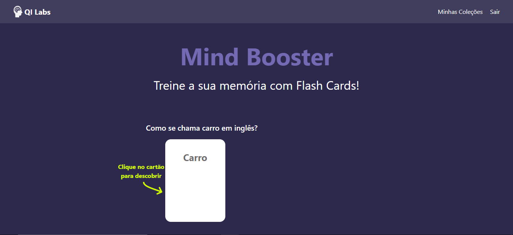
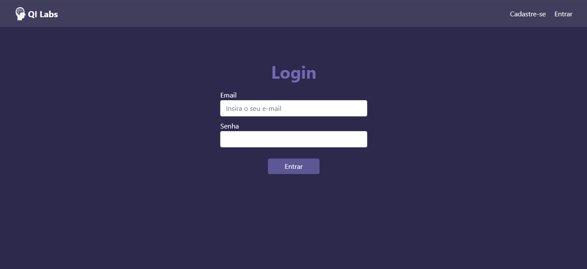
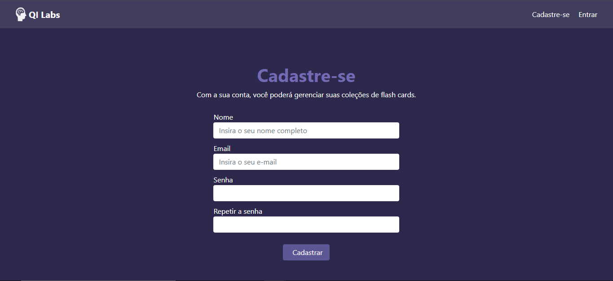
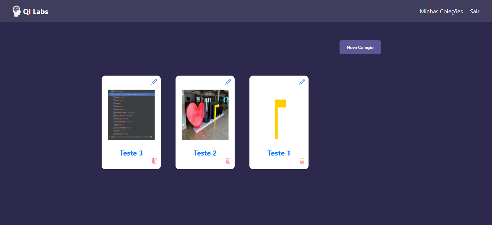
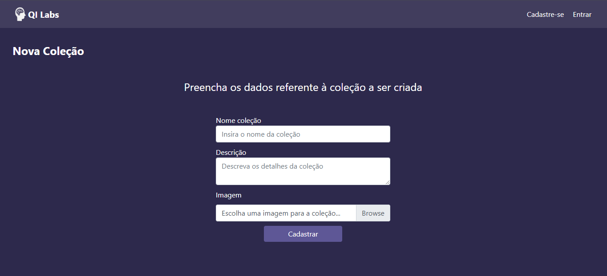
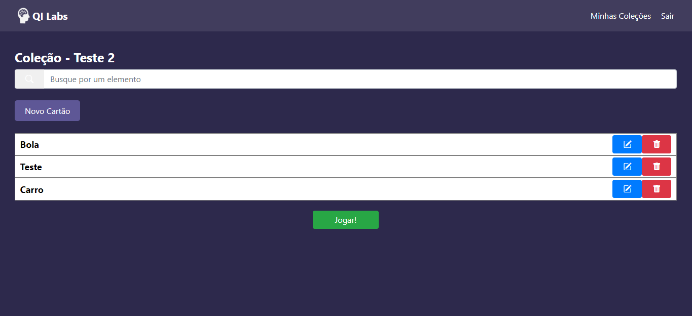
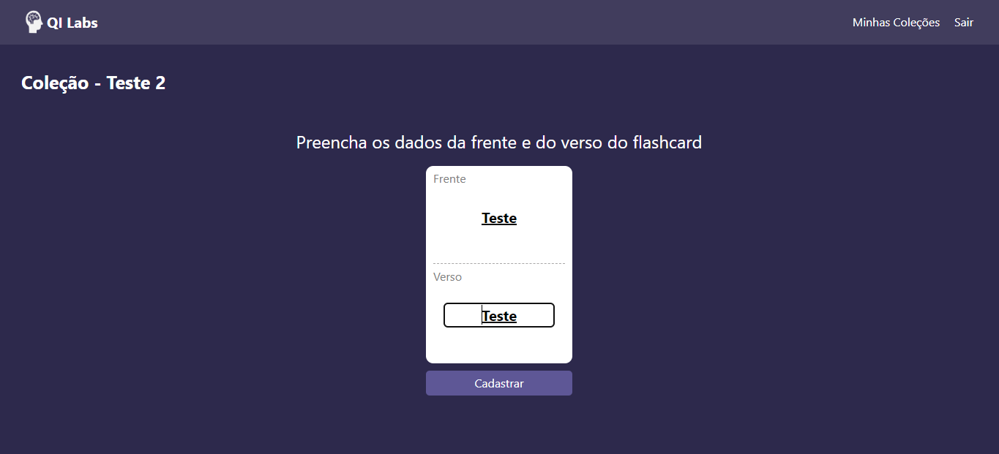
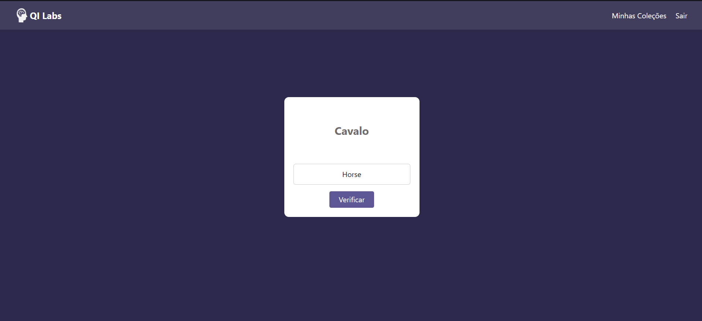
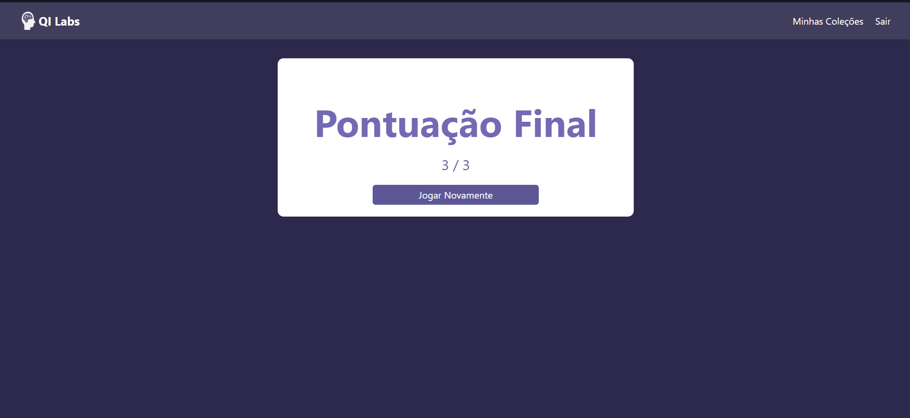

# Mind Booster

## Projeto criado para a matéria de Desenvolvimento Web 1

###  Tecnologias utilizadas

- ReactJs
- Firebase
- Redux
- React Router Dom
- Bootstrap
- HTML
- CSS

## Funcionalidades

- **Sem login:** 4 coleções de exemplo (Inglês, Capitais do Brasil, Programação e Matemática) já prontas para jogar.
- **Com login:** as coleções de exemplo continuam aparecendo e você pode criar, editar e excluir as suas próprias coleções e cartões.
- **Jogar tudo:** o botão percorre todas as coleções disponíveis (embaralhadas), corrige cada resposta e mostra a pontuação final, com acertos por coleção e lista para revisar. Também dá para jogar uma coleção só.

## Firebase

O app usa Firebase Authentication (e-mail/senha) e Cloud Firestore. Para funcionar:

1. No console do Firebase, habilite **Authentication > E-mail/senha**.
2. Crie o banco **Firestore** e publique as regras do arquivo [`firestore.rules`](firestore.rules). As regras do "modo de teste" expiram após 30 dias, e depois disso todas as leituras e escritas falham.
3. Cada coleção e cartão guarda o `uid` do dono; coleções criadas antes dessa versão (sem `uid`) não aparecem mais.

## Como rodar

```
npm install
npm start
```

# Telas

## Inicio


## Login


## Cadastro


## Home


## Nova Coleção


## Cartão


## Novo Cartão


## Jogar


## Pontuação
